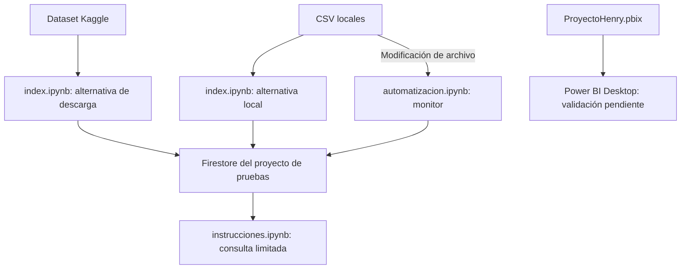

# Mapa técnico y entregas del equipo

## Flujos de la rama principal

Los bloques de carga, monitor y PBIX son artefactos presentes. No se identificó un componente en `main` que conecte Firestore con el PBIX y garantice su actualización automática.

## Operaciones y ejecución

| Archivo | Operación | Qué requiere |
|---|---|---|
| [inspeccionar_datos.py](../scripts/inspeccionar_datos.py) | Solo lectura local de CSV; sin red | Python estándar, sin credenciales. |
| [index.ipynb](../index.ipynb), opción Kaggle | Descarga datos y escribe documentos en Firestore | Internet, paquetes, permisos del dataset y ADC del proyecto de pruebas. |
| [index.ipynb](../index.ipynb), opción local | Lee las listas de CSV seleccionadas y escribe documentos en Firestore | CSV existentes, dependencias y ADC. Comprueba que exista cada archivo de la lista antes de cargarla. |
| [automatizacion.ipynb](../automatizacion.ipynb) | Observa modificaciones y recarga un CSV completo en Firestore | Proceso continuo, carpeta existente y permisos de escritura. |
| [instrucciones.ipynb](../instrucciones.ipynb) | Lee hasta cinco documentos de `player` | Permisos de lectura y colección con datos. La celda de instalación es opcional. |
| [ProyectoHenry.pbix](../Dashboard/ProyectoHenry.pbix) | Visualización y orígenes configurados dentro del artefacto | Power BI Desktop; conexiones y actualización no comprobadas. |

### Configuración local

- `PI_CSV_DIR` afecta la carga **local** y el monitor. Si no existe la variable, usan `Dashboard/csv` desde el directorio del kernel.
- La descarga de Kaggle utiliza la ruta devuelta por `kagglehub.dataset_download`; no depende de `PI_CSV_DIR`.
- La autenticación usa ADC y puede reutilizar la aplicación Firebase del kernel. Reiniciar el kernel al cambiar de proyecto o credenciales.
- Los notebooks no leen archivos `.env` automáticamente. Ver [.env.example](../.env.example) y [SECURITY.md](../SECURITY.md).
- El monitor usa `on_modified`, sin carga inicial ni recorrido recursivo. No maneja explícitamente creación, movimiento o eliminación de archivos.

### Limitaciones de carga

Las colecciones se nombran a partir del archivo sin extensión. Cada fila usa su índice como identificador de documento y se guarda mediante `set`. Por eso, volver a ejecutar puede sobrescribir documentos y reordenar filas puede cambiar qué registro ocupa cada ID. No se eliminan documentos sobrantes cuando se acorta el CSV.

Las listas locales del notebook son una selección histórica de tablas. No incorporan automáticamente todos los CSV de la carpeta. `team_info_common.csv` solo contiene encabezados, de modo que su carga no crea documentos.

Las variantes de Kaggle y local son alternativas que se solapan. Ejecutarlas todas vuelve a procesar datos. Tampoco hay validación del tamaño o esquema de cada documento antes de escribir, ni limpieza completa de valores nulos.

## Ramas históricas

Mapa consultado el 30 de octubre de 2026. Las ramas se conservan; no se fusionaron ni se reescribieron.

| Rama | Contenido observado | Estado de presentación |
|---|---|---|
| [main](https://github.com/MorandiSantiago/PI/tree/main) | CSV, notebooks Firebase, monitor y PBIX | Entrada documentada al repositorio. |
| [camilo](https://github.com/MorandiSantiago/PI/tree/camilo) | Limpieza y exportación SQLite–SQL Server en `Sprint1`; scripts de ingesta, notebooks ML y borrador `IA.py` en `Sprint2` | Entregas separadas. El borrador de IA tiene asignaciones incompletas; no demuestra una integración operativa. |
| [javier](https://github.com/MorandiSantiago/PI/tree/javier) | Notebooks `Creacion_DF`, `Creacion_DB`, `Carga DF a DB` y otro dashboard | Línea de preparación y carga a SQL Server, separada de los notebooks Firebase de main. |
| [santiago](https://github.com/MorandiSantiago/PI/tree/santiago) | README y notebooks de carga/consulta Firebase | Entrega histórica; no incorpora las correcciones recientes de main. |

No copiar configuraciones antiguas ni ejecutar esas ramas usando credenciales recuperadas del historial. Para consolidarlas hace falta revisar dependencias, rutas, configuración ausente y resultados con sus responsables.

## Autoría y siguiente consolidación

Este mapa describe dónde se encuentra cada entrega, no quién escribió cada línea. No se atribuyen al propietario del repositorio todos los desarrollos del equipo.

Antes de una consolidación funcional, corresponde acordar las contribuciones individuales, elegir qué backend y flujo se conservarán, recuperar configuración no sensible faltante y validar el resultado. La actualización documental no convierte esos componentes en un sistema desplegado o integrado.
